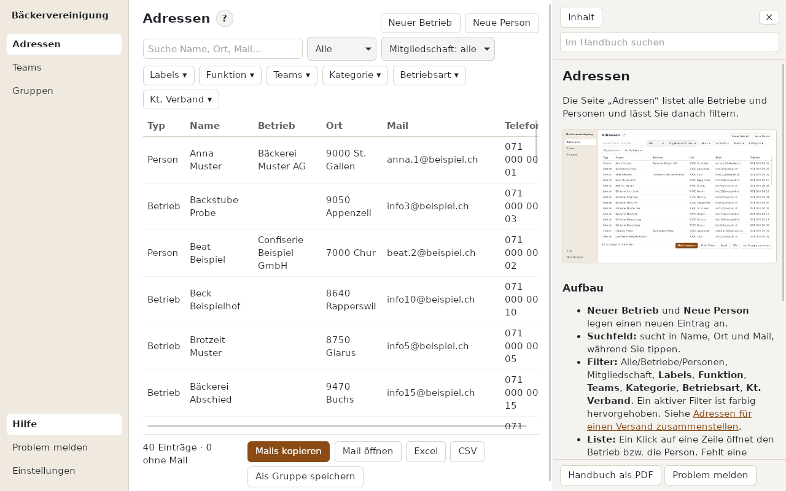

# Willkommen

Dieses Kapitel erklärt, was das Programm kann und welche Begriffe es verwendet.

Die Mitgliederverwaltung ersetzt die bisherige Excel-Liste. Alle Daten liegen in **einer Datei**, zum Beispiel auf einem Netzlaufwerk. Es gibt keine Internetverbindung und keine laufenden Kosten.

## Was Sie damit tun können

- Betriebe und Personen erfassen, ändern und finden
- Mitgliedschaften mit Kategorie, Eintritt und Austritt führen
- Adressen nach Labels, Kategorien und weiteren Merkmalen filtern
- Mailadressen für einen Versand kopieren oder als Excel-Liste exportieren
- Teams führen, zum Beispiel die Prüfungsexperten
- Daten automatisch sichern und bei Bedarf wiederherstellen

## Hilfe im Programm

Auf jeder Seite steht neben dem Titel ein **?**. Ein Klick darauf öffnet rechts die Hilfe zu genau dieser Seite. Dasselbe erreichen Sie mit der Taste **F1**. Über **Hilfe** in der linken Leiste öffnen Sie das Inhaltsverzeichnis. Oben in der Hilfe können Sie das ganze Handbuch durchsuchen.

**Bilder im Handbuch:** Blaue Nummern im Bild gehören zu den gleich nummerierten Schritten im Text. Ein blauer Rahmen zeigt, wo Sie klicken.

Die Hilfe bleibt offen, während Sie arbeiten. So können Sie einen Ablauf Schritt für Schritt nachlesen und gleichzeitig ausführen. Schliessen Sie sie mit **×**, der Taste **Esc** oder einem erneuten Klick auf **?** bzw. **Hilfe**.

## Begriffe

| Begriff | Bedeutung |
|---|---|
| **Betrieb** | Eine Bäckerei, Confiserie oder ein anderes Unternehmen mit Adresse. |
| **Person** | Ein Mensch mit Kontaktdaten. Eine Person kann zu mehreren Betrieben gehören. |
| **Funktion** | Die Rolle einer Person in einem Betrieb, zum Beispiel „Inhaber/in“. |
| **Mitgliedschaft** | Hält fest, dass ein Betrieb (oder eine Einzelperson) Mitglied ist: mit **Kategorie**, **Eintritt** und **Austritt**. |
| **Kategorie** | Art der Mitgliedschaft: „Mitglied mit Geschäft“, „Mitglied ohne Geschäft“, „Mitglied ohne SBC“ oder „Kein Mitglied“. |
| **Label** | Ein frei wählbares Merkmal, zum Beispiel „Lehrbetrieb“ oder „provisorisch“. Labels sind in **Label-Gruppen** geordnet. |
| **Gruppe** | Ein gespeicherter Filter, zum Beispiel „Vorstand“. Damit rufen Sie wiederkehrende Empfängerlisten schnell auf. |
| **Team** | Eine feste Zusammenstellung von Personen mit Rolle, zum Beispiel die Prüfungsexperten. |

## Wie es weitergeht

- [Programm starten und Datei öffnen](02-start-und-datei.md)
- [Mitglied aufnehmen](03-mitglied-aufnehmen.md)
- [Häufige Fragen und Probleme](20-haeufige-fragen.md)
