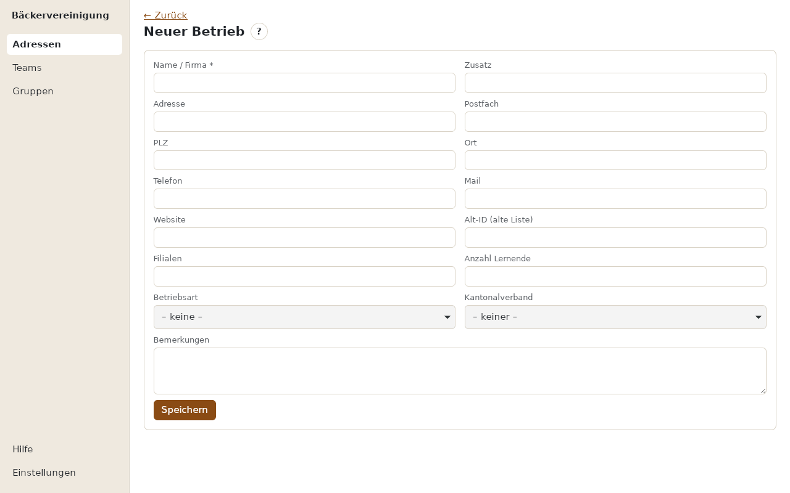
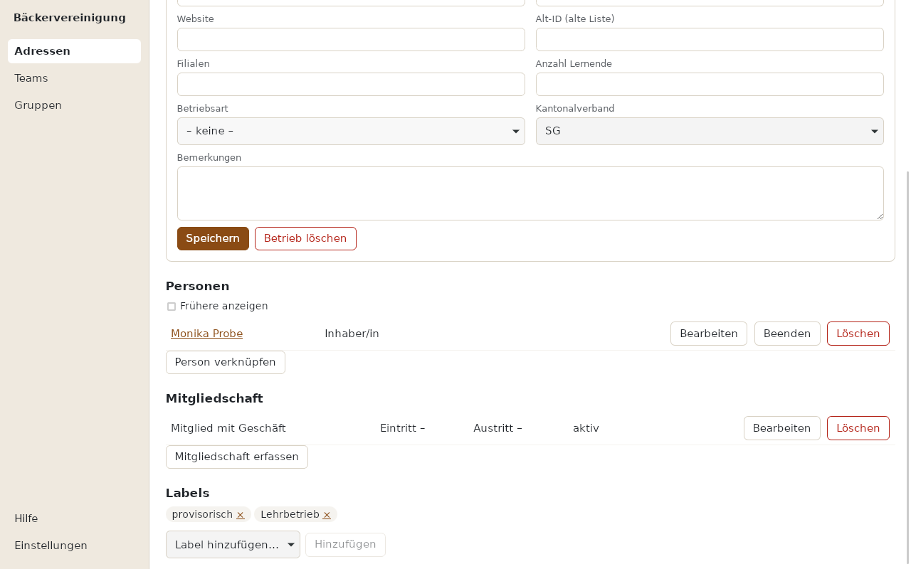
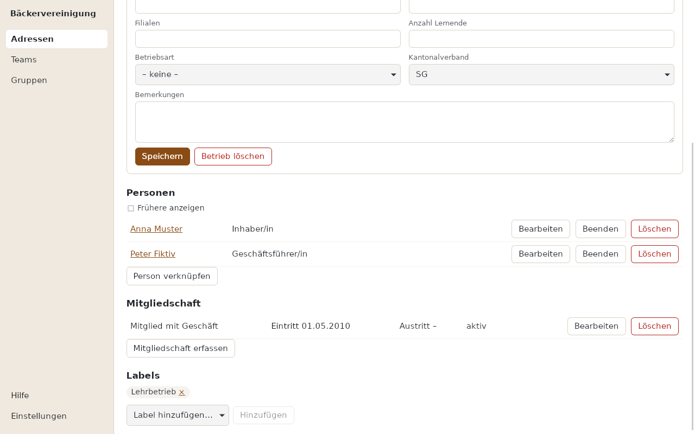

# Mitglied aufnehmen

Dieses Kapitel begleitet Sie vom Antrag bis zur offiziellen Aufnahme an der GV.

Die Aufnahme läuft in Stufen: Antrag → Vorstandssitzung (VS) → provisorisch → Generalversammlung (GV) → offiziell. Im Programm sieht das so aus:

- Ein **provisorisches** Mitglied hat eine Mitgliedschaft **ohne Eintrittsdatum** und das Label **„provisorisch“**.
- Ein **offizielles** Mitglied hat ein **Eintrittsdatum** und das Label nicht mehr.

> **Einmalig in älteren Dateien:** Fehlen unter Einstellungen die Kategorien oder das Label „provisorisch“, legen Sie sie einmal an. Wie das geht, steht unter [Listen und Labels](15-listen-und-labels.md).

## 1. Antrag erfassen

1. Gehen Sie auf **Adressen** und klicken Sie auf **Neuer Betrieb**.
2. Füllen Sie mindestens **Name / Firma** aus, dazu Adresse, Mail und Telefon. Klicken Sie auf **Speichern**.
3. Unter **Mitgliedschaft** klicken Sie auf **Mitgliedschaft erfassen**.
4. Wählen Sie die **Kategorie**, zum Beispiel „Mitglied mit Geschäft“. Lassen Sie **Eintritt** leer. Klicken Sie auf **Speichern**.
5. Unter **Labels** wählen Sie „provisorisch“ und klicken auf **Hinzufügen**.
6. Unter **Personen** klicken Sie auf **Person verknüpfen**, um die Inhaberin oder den Inhaber mit Funktion zu erfassen.

Ein Einzelmitglied ohne Betrieb erfassen Sie gleich, aber mit **Neue Person**. Die Mitgliedschaft steht dort unter **Mitgliedschaft (Einzelmitglied)**.

## 2. Nach der Vorstandssitzung

Der Vorstand hat den Antrag angenommen: Das Mitglied bleibt provisorisch, im Programm ändert sich nichts.

Danach wird die SBC benachrichtigt. Das geschieht vorerst ausserhalb des Programms. Bei der Kategorie „Mitglied ohne SBC“ entfällt dieser Schritt.

Lehnt der Vorstand ab, öffnen Sie den Betrieb und klicken auf **Betrieb löschen**. Er war nie Mitglied, darum muss nichts aufbewahrt werden.

## 3. Alle provisorischen Mitglieder finden

Zum Beispiel für die Traktandenliste der GV:

1. Gehen Sie auf **Adressen**.
2. Öffnen Sie den Filter **Labels** und wählen Sie „provisorisch“.

Die Liste zeigt nun alle provisorischen Mitglieder. Mit **Als Gruppe speichern** können Sie diese Auswahl für später speichern (siehe [Adressen für einen Versand zusammenstellen](07-versand.md)).

> **Hinweis:** Der Filter „Aktive Mitglieder“ zählt provisorische Mitglieder mit, weil sie nicht ausgetreten sind. Wer nur die offiziellen Mitglieder braucht, schaut die provisorischen über den Label-Filter separat an.

## 4. Nach der GV: offiziell aufnehmen

1. Öffnen Sie den Betrieb (auf **Adressen** in der Liste anklicken).
2. Unter **Mitgliedschaft** klicken Sie auf **Bearbeiten**, tragen bei **Eintritt** das Datum der GV ein und klicken auf **Speichern**.
3. Unter **Labels** entfernen Sie „provisorisch“ mit dem **×** neben dem Label.

Lehnt die GV ab, löschen Sie den Betrieb wie oben beschrieben.

