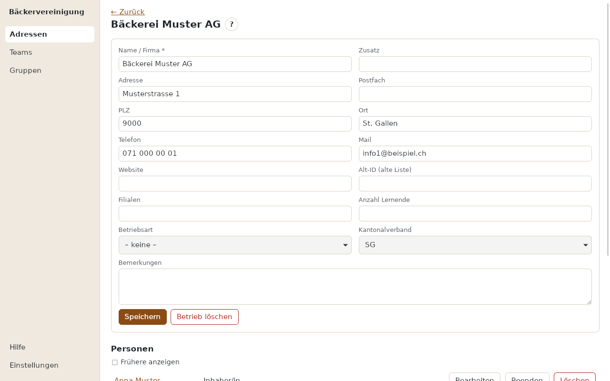
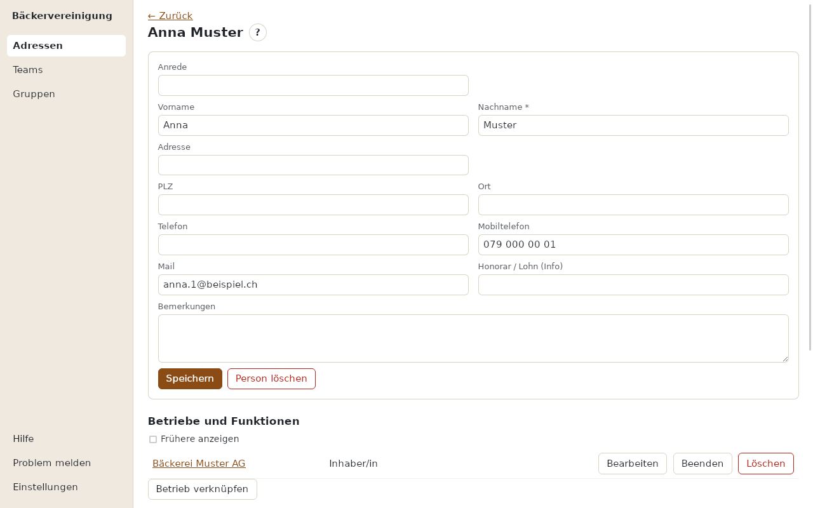

# Mitgliederdaten ändern

Dieses Kapitel zeigt, wie Sie Adressen, Personen und Funktionen anpassen.

## Adresse oder Kontaktdaten eines Betriebs ändern

1. Gehen Sie auf **Adressen** und suchen Sie den Betrieb, zum Beispiel über das Suchfeld **Suche Name, Ort, Mail…**.
2. Klicken Sie in der Liste auf den Betrieb.
3. Ändern Sie die Felder. Oben erscheint **Ungespeicherte Änderungen**.
4. Klicken Sie auf **Speichern**. Es erscheint **Gespeichert.**

Wollen Sie die Seite mit ungespeicherten Änderungen verlassen, fragt das Programm nach. So geht nichts versehentlich verloren.

## Personen eines Betriebs

Unter **Personen** sehen Sie, wer zum Betrieb gehört und mit welcher Funktion.

- **Neue Person dazu:** Klicken Sie auf **Person verknüpfen**. Wählen Sie eine bestehende Person oder „+ Neue Person anlegen…“, dann die **Funktion**, und klicken Sie auf **Speichern**.
- **Funktion ändern:** Bei der Person auf **Bearbeiten** klicken.
- **Person verlässt den Betrieb:** Klicken Sie auf **Beenden**. Die Verknüpfung bleibt als frühere Funktion erhalten und lässt sich mit **Frühere anzeigen** wieder einblenden.
- **Irrtümlich verknüpft:** **Löschen** entfernt die Verknüpfung ganz. Die Person selbst bleibt bestehen.

Fehlt eine Funktion in der Auswahl, legen Sie sie unter Einstellungen an (siehe [Listen und Labels](15-listen-und-labels.md)).

## Kontaktdaten einer Person ändern

1. Klicken Sie auf **Adressen** auf die Person, oder auf der Seite eines Betriebs auf ihren Namen.
2. Ändern Sie die Felder und klicken Sie auf **Speichern**.

Eine Person, die mehreren Betrieben angehört, erfassen Sie nur einmal. Unter **Betriebe und Funktionen** verknüpfen Sie sie mit **Betrieb verknüpfen** mit weiteren Betrieben.

## Kategorie einer Mitgliedschaft ändern

Wechselt ein Betrieb zum Beispiel von „Mitglied mit Geschäft“ zu „Mitglied ohne Geschäft“:

1. Öffnen Sie den Betrieb.
2. Unter **Mitgliedschaft** klicken Sie auf **Bearbeiten**, wählen die neue **Kategorie** und klicken auf **Speichern**.
