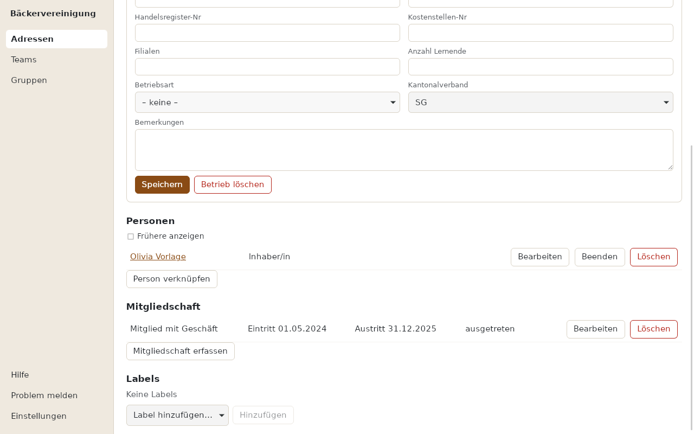

# Austritt

Dieses Kapitel zeigt, wie Sie einen Austritt erfassen, ohne die Geschichte zu verlieren.

**Ausgetretene Mitglieder werden nicht gelöscht.** Sie bekommen ein Austrittsdatum. So bleibt nachvollziehbar, wer wann Mitglied war, und die Adresse ist bei Bedarf noch da.

## Austritt erfassen

1. Gehen Sie auf **Adressen** und öffnen Sie den Betrieb (oder die Person bei einem Einzelmitglied).
2. Unter **Mitgliedschaft** klicken Sie auf **Bearbeiten**.
3. Tragen Sie bei **Austritt** das Datum ein, zum Beispiel den 31.12. des Jahres.
4. Klicken Sie auf **Speichern**.

Ab dem Austrittsdatum zählt der Betrieb nicht mehr zu den aktiven Mitgliedern. Bis dahin bleibt er aktiv. Sie können den Austritt also schon im Voraus erfassen.

## Ausgetretene finden

1. Gehen Sie auf **Adressen**.
2. Wählen Sie im Filter **Mitgliedschaft: alle** die Einstellung **Ausgetretene**.

Für Versände an alle Mitglieder wählen Sie dort **Aktive Mitglieder**. Dann sind Ausgetretene automatisch ausgeschlossen.

## Wiedereintritt

Tritt ein ehemaliges Mitglied wieder ein, klicken Sie unter **Mitgliedschaft** auf **Mitgliedschaft erfassen** und legen eine neue Mitgliedschaft mit neuem **Eintritt** an. Die alte bleibt als Geschichte stehen.

## Wann löschen?

Nur wenn jemand **nie Mitglied war**, zum Beispiel bei einem abgelehnten Antrag (siehe [Mitglied aufnehmen](03-mitglied-aufnehmen.md)), oder bei einem doppelt erfassten Eintrag. **Betrieb löschen** bzw. **Person löschen** entfernt den Eintrag mit allen Verknüpfungen. Im Notfall hilft eine [Sicherung](08-sicherung-wiederherstellen.md).
