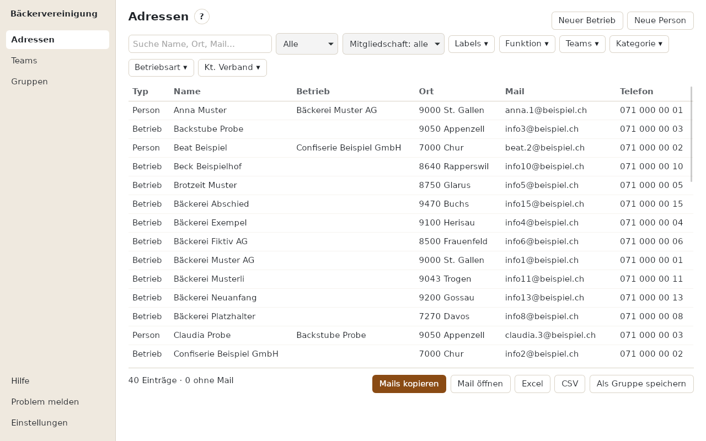

# Mitgliederdaten überprüfen

Dieses Kapitel zeigt, wie Sie die Daten aller Mitglieder kontrollieren und aktualisieren.

Von Zeit zu Zeit werden alle Mitglieder angeschrieben und gebeten, ihre Daten zu prüfen. So gehen Sie vor:

## 1. Empfänger auswählen

1. Gehen Sie auf **Adressen**.
2. Wählen Sie **Betriebe** statt **Alle** und bei der Mitgliedschaft **Aktive Mitglieder**.

Unten sehen Sie, wie viele Einträge gefunden wurden und wie viele davon **ohne Mail** sind. Mit **Ohne Mail anzeigen** sehen Sie, wen Sie per Post oder Telefon erreichen müssen.

## 2. Anschreiben

- **Mails kopieren** kopiert alle Mailadressen. Fügen Sie sie in Outlook im Feld **Bcc** ein, damit die Empfänger einander nicht sehen.
- **Mail öffnen** öffnet direkt Ihr Mailprogramm mit allen Adressen im Bcc. Bei sehr vielen Adressen geht das nicht. Dann erscheint ein Hinweis, und Sie nehmen **Mails kopieren**.
- **Excel** oder **CSV** speichert die Liste, zum Beispiel für einen Serienbrief.

## 3. Rückmeldungen einpflegen

Für jede Korrektur öffnen Sie den Betrieb oder die Person, ändern die Daten und klicken auf **Speichern** (siehe [Mitgliederdaten ändern](04-daten-aendern.md)).

Tipp: In **Bemerkungen** können Sie festhalten, wann die Daten zuletzt bestätigt wurden.
