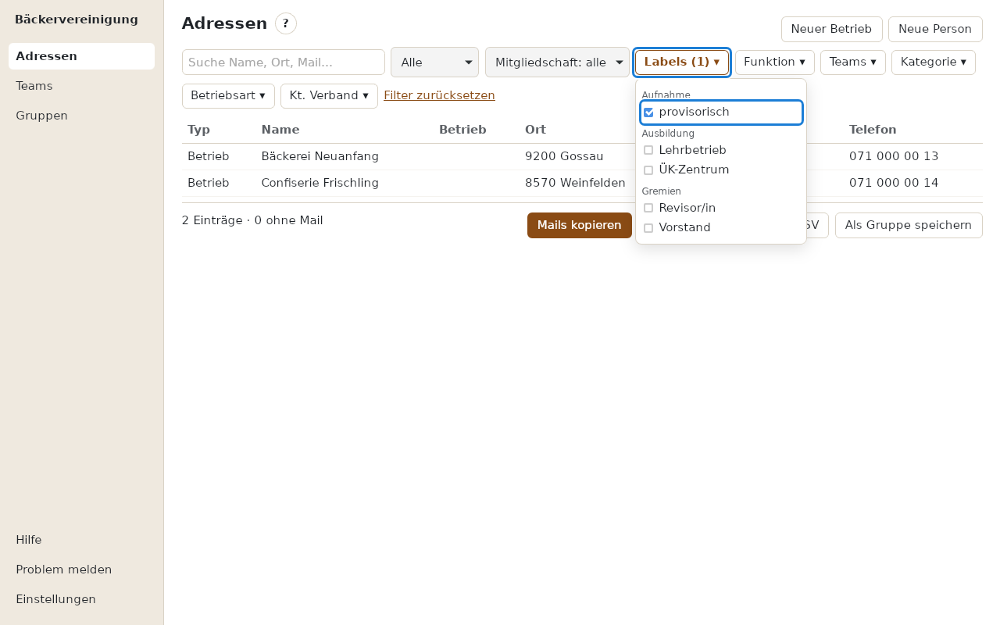
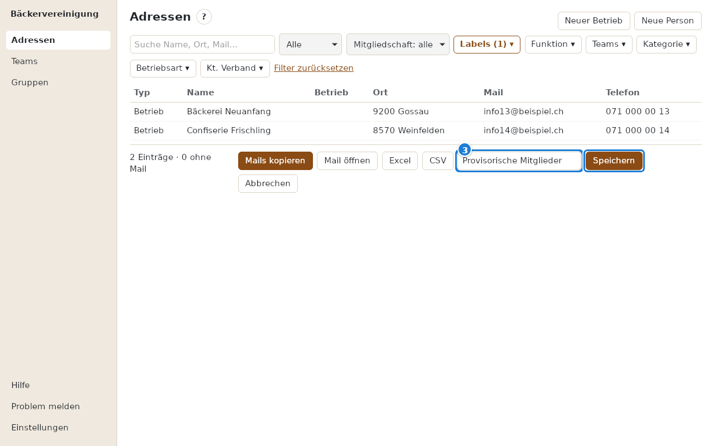

# Adressen für einen Versand zusammenstellen

Dieses Kapitel zeigt, wie Sie Empfänger auswählen, als Gruppe speichern und exportieren.

## Empfänger filtern

Auf der Seite **Adressen** lassen sich Filter beliebig kombinieren:

- **Suchfeld:** Name, Ort oder Mail
- **Alle / Betriebe / Personen**
- **Mitgliedschaft:** alle, **Aktive Mitglieder** oder **Ausgetretene**
- **Labels**, **Funktion**, **Teams**, **Kategorie**, **Betriebsart**, **Kt. Verband**: Klicken Sie auf den Filter und haken Sie die gewünschten Einträge an.

Mehrere Einträge im selben Filter heissen „eines davon“. Verschiedene Filter müssen alle zutreffen, zum Beispiel Label „Lehrbetrieb“ **und** Kategorie „Mitglied mit Geschäft“. Bei Labels gilt: Labels aus derselben Label-Gruppe heissen „eines davon“, Labels aus verschiedenen Label-Gruppen müssen alle zutreffen.

**Filter zurücksetzen** leert alle Filter wieder.

## Als Gruppe speichern

Brauchen Sie dieselbe Auswahl öfter, zum Beispiel „Vorstand“ oder „Lehrbetriebe“:

1. Stellen Sie den Filter zusammen.
2. Klicken Sie unten auf **Als Gruppe speichern**.
3. Geben Sie einen Namen ein und klicken Sie auf **Speichern**.

Die Gruppe finden Sie danach unter **Gruppen** (siehe [Gruppen](13-gruppen.md)). Eine Gruppe speichert den **Filter**, nicht die Namen. Kommt ein neuer Lehrbetrieb dazu, ist er beim nächsten Aufruf automatisch dabei.

## Versenden oder exportieren

- **Mails kopieren** und in Outlook unter **Bcc** einfügen
- **Mail öffnen** öffnet das Mailprogramm direkt
- **Excel** oder **CSV** für Serienbriefe und Etiketten

Für ein Team geht es schneller mit **Team anschreiben** auf der Seite [Teams](14-teams.md).
