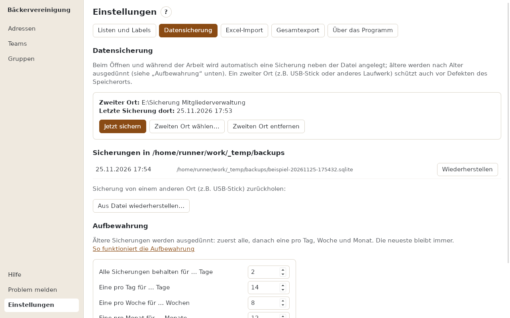

# Datensicherung und Wiederherstellen

Dieses Kapitel erklärt, wie Ihre Daten gesichert werden und wie Sie eine Sicherung zurückspielen.

## Was automatisch passiert

- **Bei jedem Öffnen** legt das Programm neben der Datei eine Sicherung an (Ordner mit den Sicherungen, die letzten 20 bleiben).
- **Beim Schliessen** legt es zusätzlich eine Kopie am **zweiten Ort** ab, wenn einer eingerichtet ist.
- Ist kein zweiter Ort eingerichtet oder die letzte Kopie dort älter als 30 Tage, erinnert eine gelbe Leiste daran.

## Zweiten Sicherungsort einrichten

Ein zweiter Ort schützt auch dann, wenn das Netzlaufwerk oder der PC ausfällt. Geeignet ist zum Beispiel ein USB-Stick oder ein anderes Laufwerk.

1. Gehen Sie auf **Einstellungen** › **Datensicherung**.
2. Klicken Sie auf **Zweiten Ort wählen…** und wählen Sie den Ordner.
3. Klicken Sie auf **Jetzt sichern**, um gleich eine erste Kopie anzulegen.

## Eine Sicherung zurückspielen

Zum Beispiel, wenn versehentlich etwas gelöscht wurde.

1. Gehen Sie auf **Einstellungen** › **Datensicherung**.
2. Suchen Sie in der Liste den Stand vor dem Fehler (Datum und Uhrzeit).
3. Klicken Sie auf **Wiederherstellen** und bestätigen Sie die Rückfrage.

Bevor das Programm ersetzt, sichert es den aktuellen Stand. Sie können den Schritt also rückgängig machen, indem Sie diese neueste Sicherung wiederherstellen.

**Sicherung vom USB-Stick:** Klicken Sie auf **Aus Datei wiederherstellen…** und wählen Sie die Sicherungsdatei.

> **Achtung:** Alles, was nach dem gewählten Stand erfasst wurde, ist danach nicht mehr in der Datei. Notieren Sie wichtige Änderungen vorher.

## Alles exportieren

Zusätzlich zu den Sicherungen können Sie alle Daten als Excel-Datei speichern, die auch ohne dieses Programm lesbar ist (siehe [Gesamtexport](18-gesamtexport.md)).
