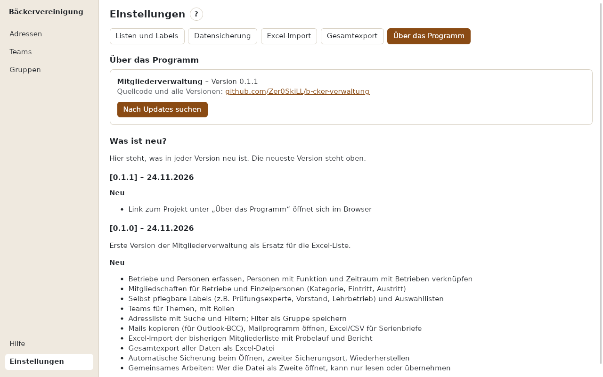

# Neue Version installieren

Dieses Kapitel erklärt, wie das Programm Updates anbietet und installiert.

## So erfahren Sie von einer neuen Version

Das Programm prüft beim Start, ob es eine neue Version gibt (dafür braucht es Internet). Wenn ja, erscheint oben eine gelbe Leiste:

> Version 0.2.0 ist verfügbar

Unter **Was ist neu?** steht, was sich geändert hat.

Sie können auch selbst nachsehen: **Einstellungen** › **Über das Programm** › **Nach Updates suchen**.

## Installieren

1. Speichern Sie offene Änderungen.
2. Klicken Sie auf **Jetzt installieren**.
3. Das Programm schliesst die Datei, lädt das Update und startet neu. Das dauert meist unter einer Minute.
4. Öffnen Sie die Datei auf der Startseite mit **Öffnen** wieder.

Die Daten bleiben dabei unverändert. Sie liegen in Ihrer Datei, nicht im Programm.

## Wenn etwas schiefgeht

Schlägt das Update fehl, zeigt das Programm eine Meldung mit zwei Knöpfen:

- **Erneut versuchen** startet das Update nochmals, zum Beispiel wenn die Internetverbindung kurz weg war.
- **Datei wieder öffnen** öffnet Ihre Datei wieder, und Sie arbeiten mit der bisherigen Version weiter.

Siehe auch [Häufige Fragen und Probleme](20-haeufige-fragen.md).
