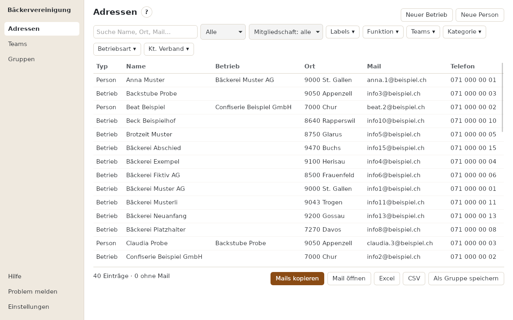

# Adressen

Die Seite „Adressen“ listet alle Betriebe und Personen und lässt Sie danach filtern.

## Aufbau

- **Neuer Betrieb** und **Neue Person** legen einen neuen Eintrag an.
- **Suchfeld:** sucht in Name, Ort und Mail, während Sie tippen.
- **Filter:** Alle/Betriebe/Personen, Mitgliedschaft, **Labels**, **Funktion**, **Teams**, **Kategorie**, **Betriebsart**, **Kt. Verband**. Ein aktiver Filter ist farbig hervorgehoben. Siehe [Adressen für einen Versand zusammenstellen](07-versand.md).
- **Liste:** Ein Klick auf eine Zeile öffnet den Betrieb bzw. die Person. Fehlt eine Mailadresse, steht in der Spalte **Mail** rot „fehlt“.
- **Unten:** Anzahl Einträge und ohne Mail, dazu **Mails kopieren**, **Mail öffnen**, **Excel**, **CSV** und **Als Gruppe speichern**.

## Gut zu wissen

- Bei Personen zeigt die Spalte **Betrieb** die aktuellen Betriebe.
- Wenn Sie von einem Betrieb mit **← Zurück** zur Liste zurückkehren, bleiben Ihre Filter erhalten.
- Ist die Datei nur zum Lesen geöffnet, sind die Knöpfe zum Anlegen ausgegraut (siehe [Programm starten und Datei öffnen](02-start-und-datei.md)).
