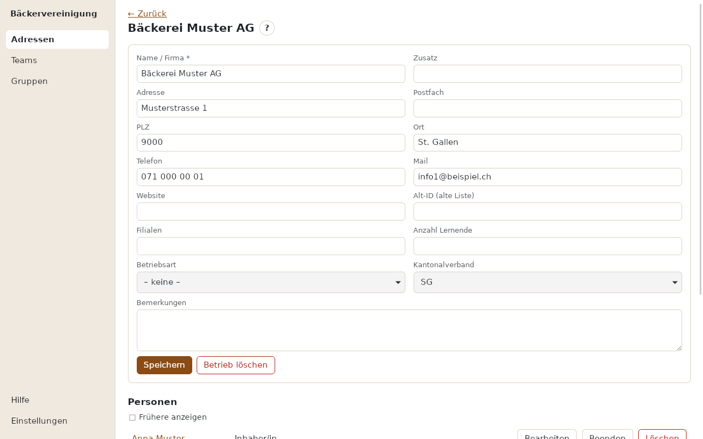

# Betrieb

Auf der Seite eines Betriebs pflegen Sie Adresse, Personen, Mitgliedschaft und Labels.

## Felder

**Name / Firma** ist Pflicht. Dazu kommen Zusatz, Adresse, Postfach, PLZ, Ort, Telefon, Mail, Website, Betriebsart, Kantonalverband, Filialen, Anzahl Lernende, Bemerkungen und Alt-ID (alte Liste, aus dem Excel-Import).

Ändern Sie Felder, erscheint **Ungespeicherte Änderungen**. Erst **Speichern** übernimmt sie.

## Bereiche

- **Personen:** Wer gehört zum Betrieb, mit welcher Funktion. **Person verknüpfen** fügt jemanden hinzu, **Beenden** beendet eine Funktion (bleibt als frühere erhalten), **Frühere anzeigen** blendet beendete ein.
- **Mitgliedschaft:** Kategorie, Eintritt und Austritt. **Mitgliedschaft erfassen** legt eine an, **Bearbeiten** ändert sie. Siehe [Mitglied aufnehmen](03-mitglied-aufnehmen.md) und [Austritt](05-austritt.md).
- **Labels:** Auswahl „Label hinzufügen…“ und **Hinzufügen**. Das **×** neben einem Label entfernt es.

## Löschen

**Betrieb löschen** entfernt den Betrieb mit allen Verknüpfungen, nach einer Rückfrage. Bei einem Austritt nicht löschen, sondern ein Austrittsdatum setzen.
