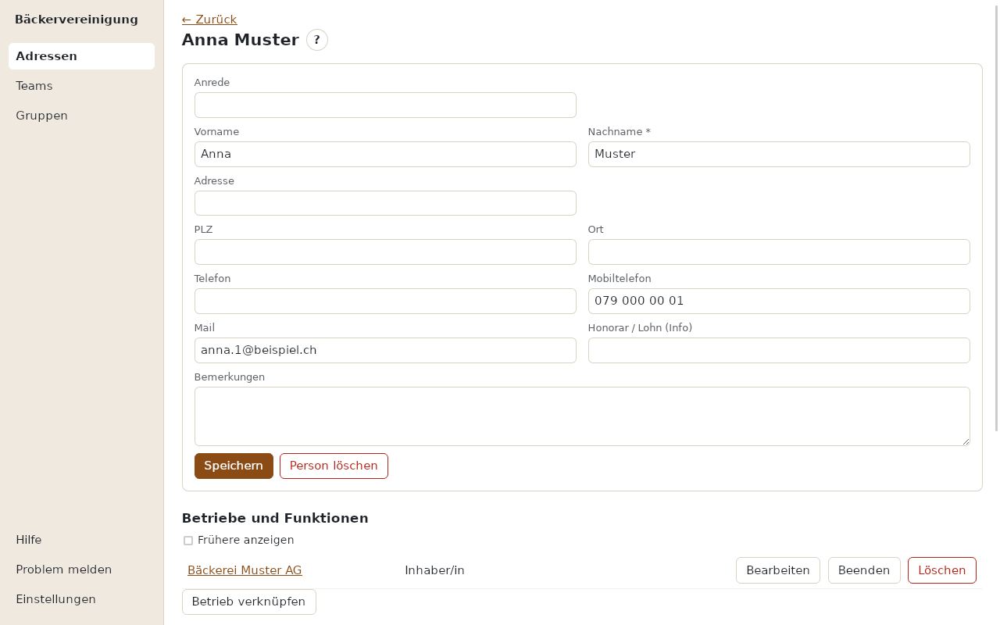

# Person

Auf der Seite einer Person pflegen Sie Kontaktdaten, Betriebe, Funktionen, Labels und Teams.

## Felder

**Nachname** ist Pflicht. Dazu kommen Anrede, Vorname, Adresse, PLZ, Ort, Telefon, Mobiltelefon, Mail, Honorar / Lohn (Info) und Bemerkungen.

## Bereiche

- **Betriebe und Funktionen:** Bei welchen Betrieben die Person tätig ist. **Betrieb verknüpfen** fügt einen Betrieb hinzu.
- **Mitgliedschaft (Einzelmitglied):** Nur für Personen, die selbst Mitglied sind, ohne Betrieb. Die Mitgliedschaft eines Betriebs gehört auf die Seite des Betriebs.
- **Labels:** wie beim Betrieb, zum Beispiel „Vorstand“.
- **Teams:** In welchen Teams die Person ist. **Teams bearbeiten** führt zur Seite [Teams](14-teams.md).

## Löschen

**Person löschen** entfernt die Person mit allen Verknüpfungen, nach einer Rückfrage.
