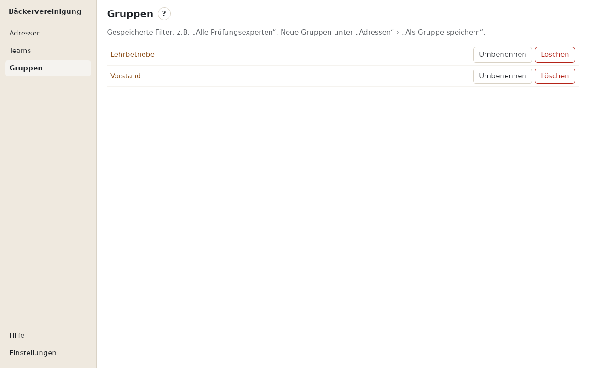

# Gruppen

Gruppen sind gespeicherte Filter, mit denen Sie wiederkehrende Empfängerlisten schnell aufrufen.

## Bedienung

- **Klick auf den Namen:** öffnet **Adressen** mit diesem Filter. Dort können Sie wie gewohnt kopieren, exportieren oder den Filter weiter anpassen.
- **Umbenennen:** Namen ändern und **Speichern**.
- **Löschen:** entfernt nur die Gruppe, nicht die Adressen.

## Neue Gruppe

Gruppen entstehen auf der Seite **Adressen** mit **Als Gruppe speichern**. Siehe [Adressen für einen Versand zusammenstellen](07-versand.md).

Eine Gruppe speichert den Filter, nicht die einzelnen Namen. Neue passende Einträge sind darum automatisch dabei.
