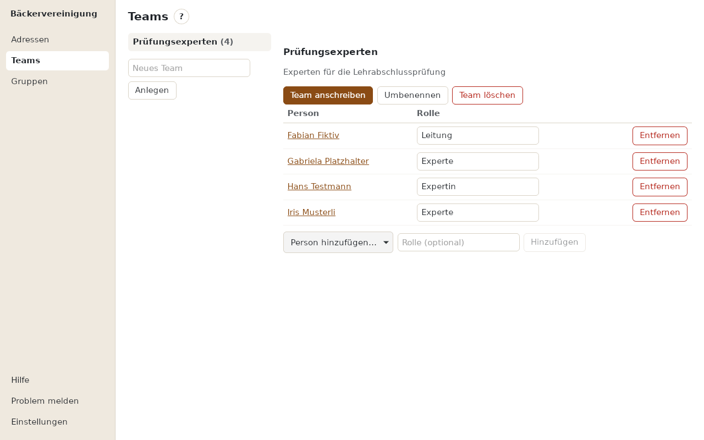

# Teams

Teams fassen Personen für eine Aufgabe zusammen, zum Beispiel die Prüfungsexperten.

## Team anlegen

Geben Sie links unter der Liste einen Namen in **Neues Team** ein und klicken Sie auf **Anlegen**.

## Team bearbeiten

Wählen Sie links ein Team aus. Rechts sehen Sie die Mitglieder.

- **Person hinzufügen:** Person auswählen, optional eine **Rolle** eingeben (zum Beispiel „Leitung“), dann **Hinzufügen**.
- **Rolle ändern:** direkt im Feld bei der Person.
- **Entfernen:** nimmt die Person aus dem Team. Die Person selbst bleibt bestehen.
- **Umbenennen:** Name und Beschreibung des Teams ändern.
- **Team anschreiben:** öffnet **Adressen** mit allen Mitgliedern des Teams. Dort kopieren Sie die Mailadressen oder öffnen das Mailprogramm.
- **Team löschen:** entfernt das Team, nicht die Personen.

## Teams im Adressfilter

Auf **Adressen** gibt es den Filter **Teams**. So kombinieren Sie ein Team mit anderen Merkmalen.
