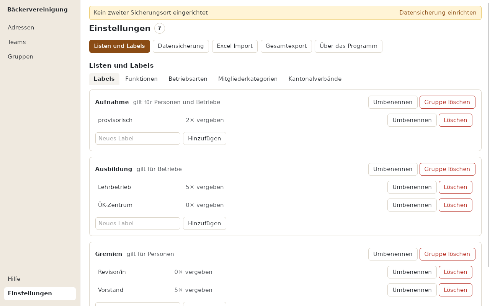
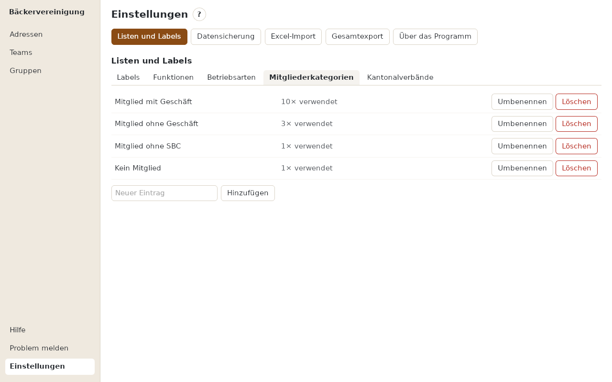

# Listen und Labels

Hier verwalten Sie Auswahllisten wie Mitgliederkategorien sowie Label-Gruppen und Labels.

Sie finden die Seite unter **Einstellungen** › **Listen und Labels**. Oben wählen Sie, was Sie bearbeiten: **Labels**, **Funktionen**, **Betriebsarten**, **Mitgliederkategorien** oder **Kantonalverbände**.

## Labels

Labels sind in Gruppen geordnet. Jede Gruppe gilt für Personen, für Betriebe oder für beide.

- **Neue Gruppe:** Namen in **Neue Gruppe** eingeben, bei „Gilt für“ wählen und auf **Gruppe anlegen** klicken.
- **Neues Label:** In der Gruppe den Namen in **Neues Label** eingeben und auf **Hinzufügen** klicken.
- **Umbenennen** und **Löschen** gibt es für Gruppen und Labels. Bei jedem Label steht, wie oft es vergeben ist. Ist es vergeben, fragt das Programm vor dem Löschen nach.

## Auswahllisten

**Funktionen**, **Betriebsarten**, **Mitgliederkategorien** und **Kantonalverbände** erscheinen als Auswahl in den Formularen. Neue Einträge legen Sie mit **Neuer Eintrag** und **Hinzufügen** an.

## Vorgaben für die Aufnahme einmalig anlegen

Neue Dateien enthalten die Vorgaben bereits. In einer älteren Datei legen Sie sie einmal so an:

1. **Mitgliederkategorien** wählen und nacheinander anlegen (genau so geschrieben):
   - Mitglied mit Geschäft
   - Mitglied ohne Geschäft
   - Mitglied ohne SBC
   - Kein Mitglied
2. **Labels** wählen. Neue Gruppe „Aufnahme“ für **beide** anlegen und darin das Label „provisorisch“.

Wofür das gebraucht wird, steht unter [Mitglied aufnehmen](03-mitglied-aufnehmen.md).
