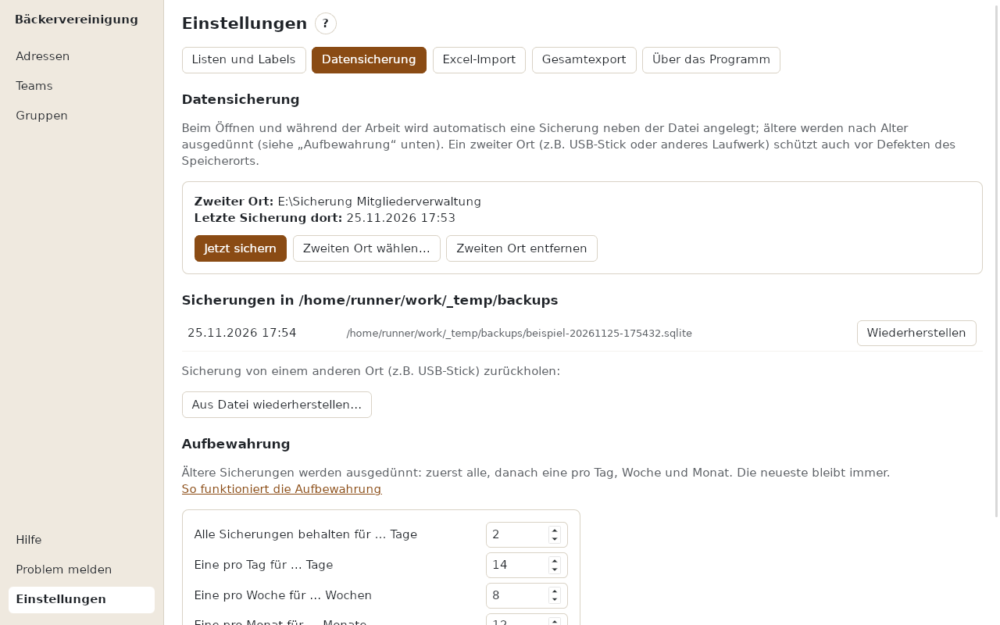
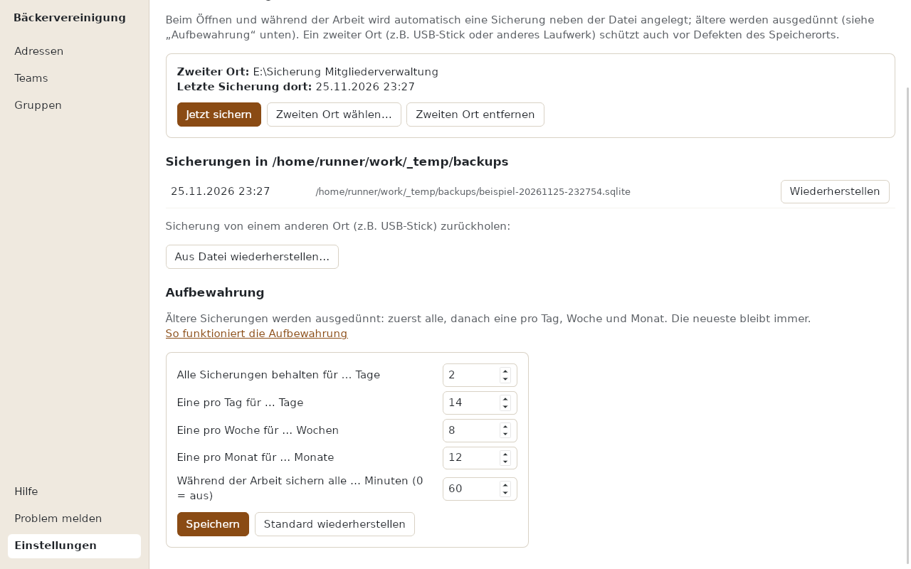

# Datensicherung

Hier sehen Sie die vorhandenen Sicherungen und legen den zweiten Sicherungsort fest.

Sie finden die Seite unter **Einstellungen** › **Datensicherung**.

## Aufbau

- **Zweiter Ort** und **Letzte Sicherung dort:** wohin zusätzlich gesichert wird und wann zuletzt.
- **Jetzt sichern:** legt sofort eine Sicherung an, neben der Datei und, falls eingerichtet, am zweiten Ort.
- **Zweiten Ort wählen…** und **Zweiten Ort entfernen**
- **Sicherungen in …:** alle Sicherungen neben der Datei, mit Datum. **Wiederherstellen** spielt eine davon zurück.
- **Aus Datei wiederherstellen…:** eine Sicherung von einem anderen Ort zurückholen, zum Beispiel vom USB-Stick.

## Aufbewahrung

Im Bereich **Aufbewahrung** legen Sie fest, wie lange Sicherungen behalten werden und wie oft während der Arbeit gesichert wird:

- **Alle Sicherungen behalten für … Tage** (Standard 2)
- **Eine pro Tag für … Tage** (Standard 14)
- **Eine pro Woche für … Wochen** (Standard 8)
- **Eine pro Monat für … Monate** (Standard 12)
- **Während der Arbeit sichern alle … Minuten (0 = aus)** (Standard 60)

Mit **Speichern** übernehmen Sie die Werte, **Standard wiederherstellen** setzt die Vorgaben. Die Einstellungen gelten für alle, die diese Datei öffnen. Was die Werte bedeuten, zeigt die Tabelle unter [Datensicherung und Wiederherstellen](08-sicherung-wiederherstellen.md).

Ausführlich mit allen Schritten: [Datensicherung und Wiederherstellen](08-sicherung-wiederherstellen.md).
