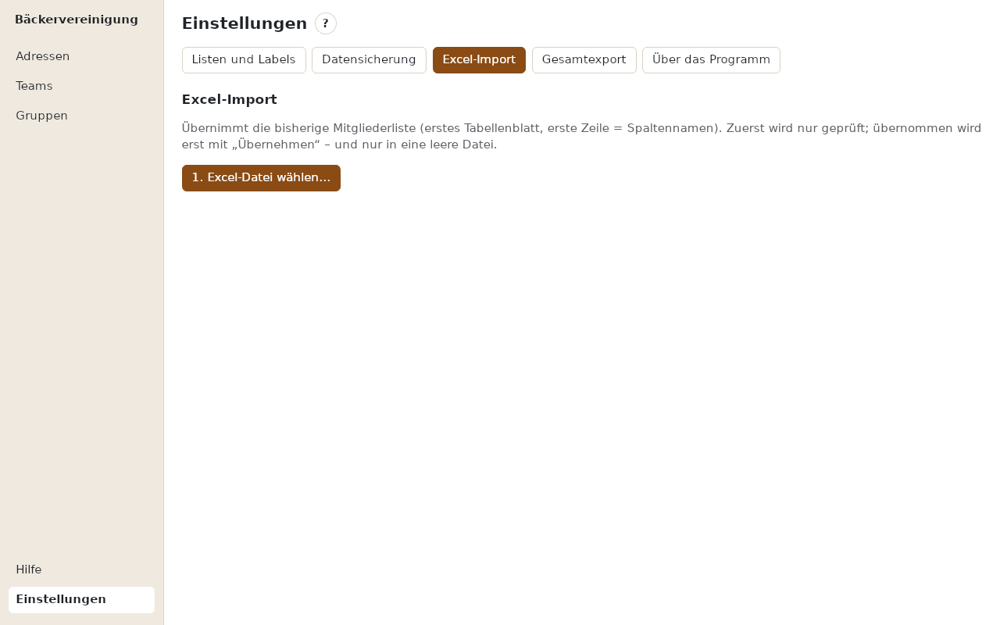

# Excel-Import

Mit dem Excel-Import übernehmen Sie Adressen aus einer bestehenden Excel-Liste.

Sie finden die Seite unter **Einstellungen** › **Excel-Import**. Der Import ist für den Umstieg von der bisherigen Liste gedacht und funktioniert nur in eine **leere Datei**.

## Ablauf

1. **1. Excel-Datei wählen…**: Das Programm liest das erste Tabellenblatt. Die erste Zeile muss die Spaltennamen enthalten.
2. **2. Spalten zuordnen und prüfen**: Für jede Spalte der Datei wählen Sie, als was sie übernommen wird. Das Programm schlägt eine Zuordnung vor. Darunter sehen Sie eine Vorschau und Hinweise zu einzelnen Zeilen.
3. **3. Übernehmen**: Erst jetzt werden die Daten gespeichert.

Nach dem Import zeigt ein Bericht, was übernommen wurde und welche Zeilen Hinweise haben. **Bericht als CSV speichern…** speichert ihn zum Nacharbeiten.

## Tipps

- Machen Sie zuerst einen Probedurchlauf: Bis **Übernehmen** wird nichts gespeichert.
- Kategorien, Funktionen und Labels, die es noch nicht gibt, legt der Import an. Bestehende mit gleichem Namen werden weiterverwendet.
