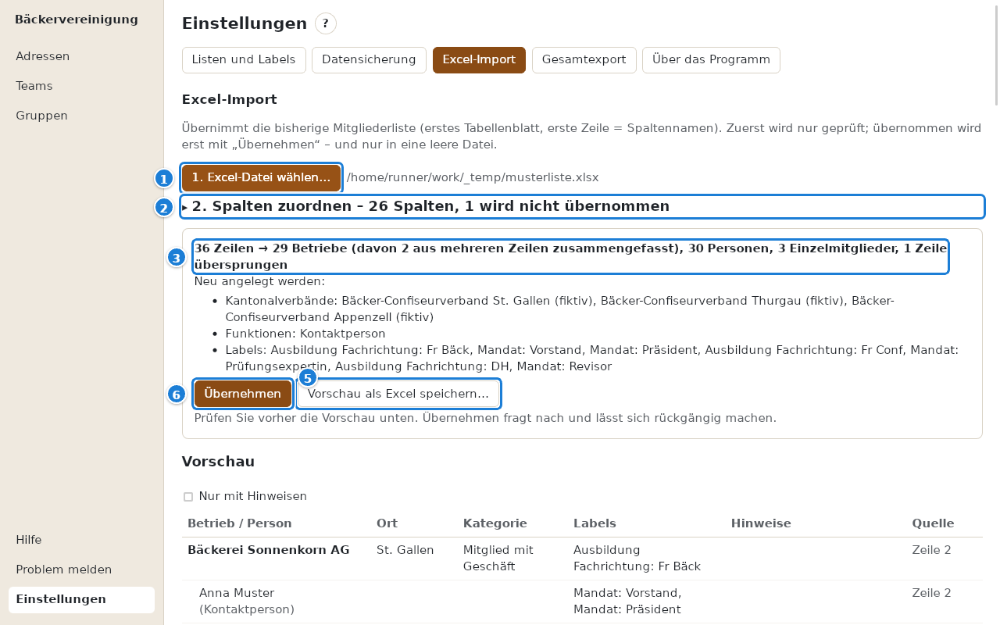
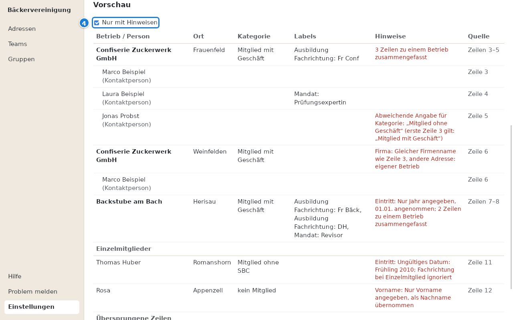

# Excel-Import

Mit dem Excel-Import übernehmen Sie die bisherige Mitgliederliste aus Excel ins Programm.

Sie finden die Seite unter **Einstellungen** › **Excel-Import**. Der Import ist für den Umstieg gedacht und funktioniert nur in eine **leere Datei** – vorhandene Daten können also nie überschrieben werden.

## Empfohlener Ablauf: zuerst eine Testdatei

1. Auf der Startseite mit **Neue Datei anlegen…** eine Testdatei anlegen, zum Beispiel „Test.sqlite“.
2. Dort importieren (siehe unten) und sich in Ruhe umsehen: Stimmen Betriebe, Personen, Kategorien und Labels?
3. Passt alles, die Testdatei schliessen und löschen, die echte Datei anlegen (siehe [Einrichten: allein oder zu mehreren](02b-einrichten.md)) und dort importieren.

## Schritt für Schritt

1. **1. Excel-Datei wählen…**: Das Programm liest das erste Tabellenblatt. Die erste Zeile muss die Spaltennamen enthalten.
2. **2. Spalten zuordnen**: Die Spalten der Mitgliederliste werden automatisch erkannt. Die Überschrift nennt, wie viele Spalten es sind und wie viele nicht übernommen werden. Nur wenn eine Spalte falsch erkannt wurde, klappen Sie den Bereich auf und ändern die Zuordnung; die Vorschau passt sich sofort an.
3. Darunter steht eine **Zusammenfassung**, zum Beispiel „290 Zeilen → 210 Betriebe (davon 15 aus mehreren Zeilen zusammengefasst), 240 Personen, 12 Einzelmitglieder, 0 Zeilen übersprungen“, und was **neu angelegt** würde (Kategorien, Kantonalverbände, Funktionen, Labels).
4. Die **Vorschau** zeigt jeden Betrieb mit seinen Personen, danach die Einzelmitglieder und übersprungene Zeilen – mit der Zeilennummer aus der Excel-Datei. Mit **Nur mit Hinweisen** sehen Sie nur, was Sie ansehen sollten.
5. **Vorschau als Excel speichern…** (in der Zusammenfassung) legt eine Liste an, Zeile für Zeile, zum Vergleich mit der Originalliste.
6. **Übernehmen** (ebenfalls in der Zusammenfassung): Das Programm fragt mit den Zahlen nach („… anlegen?“). Erst jetzt wird gespeichert, und zwar alles oder nichts.

Ganz unten steht der eingeklappte **Import-Bericht** mit allen Hinweisen als Liste; **Bericht als CSV speichern…** speichert ihn zum Nacharbeiten.

## Rückgängig machen

Unmittelbar vor dem Import legt das Programm eine Sicherung an. Nach dem Import steht **Import rückgängig machen** bereit: Nach einer Rückfrage ist die Datei wieder auf dem Stand davor. Haben Sie die Seite schon verlassen, finden Sie dieselbe Sicherung unter **Einstellungen** › **Datensicherung** (am Zeitpunkt des Imports erkennbar). Wegen der Aufbewahrung bleibt sie dort aber nur etwa bis zum übernächsten Arbeitstag einzeln erhalten – prüfen Sie den Import darum gleich danach.

## Wie die Liste gelesen wird

| Spalte | Wird zu |
|---|---|
| Firma | Betrieb |
| Name, Vorname | Person, verknüpft mit dem Betrieb, Funktion **Kontaktperson** (danach änderbar) |
| Zusatz/Inhaber (Handelsregister) | Zusatz des Betriebs |
| OBC-ID | Alt-ID des Betriebs |
| Kt Verband, Adresse, PLZ, Ort, Mail, Home, Telefon, Filialen | Angaben des Betriebs |
| Mobiltelefon | Mobiltelefon der Person |
| Kategorie, Eintritt, Austritt | Mitgliedschaft |
| Fr Bäck, Fr Conf, DH | Labels in „Ausbildung Fachrichtung“ (bei „Lehrbetrieb“ ohne Fachrichtung erscheint ein Hinweis) |
| Mandat | Labels in „Mandat“ – bei der Person der Zeile, sonst beim Betrieb; mehrere mit Komma trennen |
| Besonderes | Bemerkungen |
| Handelsregister-Nr, Kostenstellen-Nr | gleichnamige Felder des Betriebs |
| Adresszusatz | wird nicht übernommen |

Dazu gelten diese Regeln:

- **Mehrere Zeilen derselben Firma** an derselben Adresse werden **ein** Betrieb mit mehreren Personen. Gleich heissende Betriebe an anderer Adresse bleiben getrennt.
- Weichen in einer weiteren Zeile **Mail, Telefon, Besonderes oder OBC-ID** vom Betrieb ab, gehören sie zur **Person dieser Zeile**. Weicht etwas ab, das nur einmal pro Betrieb gelten kann (zum Beispiel die Kategorie), gilt die erste Zeile, und der Bericht nennt die Abweichung.
- **Zeilen ohne Firma**, aber mit Name werden **Einzelmitglieder** (Person mit eigener Mitgliedschaft).
- Zeilen ganz ohne Firma und Name werden übersprungen und im Bericht genannt.
- Gleicher Firmenname an **anderer** Adresse ergibt einen eigenen Betrieb; der Bericht weist darauf hin.
- Angaben, die es nur bei Betrieben gibt (zum Beispiel Kantonalverband oder Handelsregister-Nr), landen bei Einzelmitgliedern in den Bemerkungen.
- Kategorien und Listen werden ohne Rücksicht auf Gross- und Kleinschreibung erkannt: „kein Mitglied“ wird zu „Kein Mitglied“.
