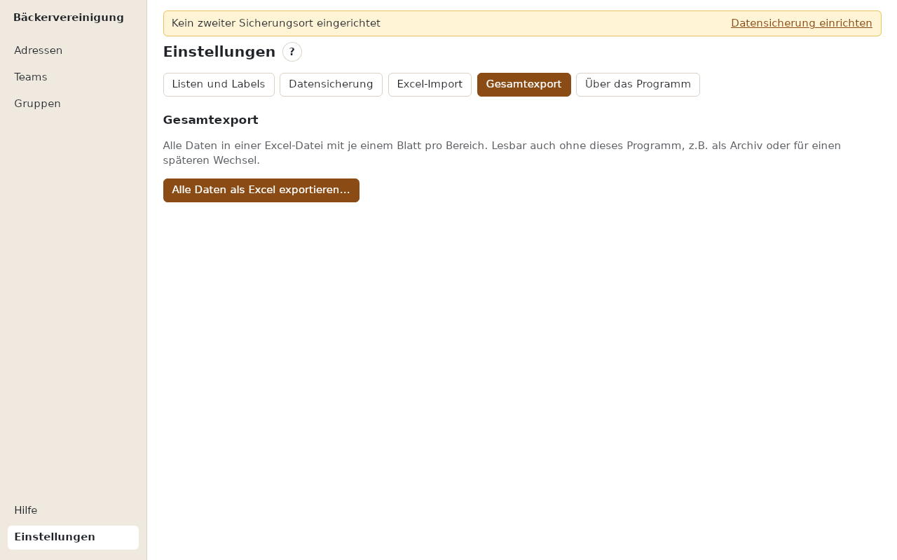

# Gesamtexport

Der Gesamtexport schreibt alle Daten in eine Excel-Datei, zum Beispiel zur Archivierung.

Sie finden die Seite unter **Einstellungen** › **Gesamtexport**.

1. Klicken Sie auf **Alle Daten als Excel exportieren…**.
2. Wählen Sie Ort und Namen der Datei.

Die Excel-Datei hat je ein Blatt pro Bereich (Betriebe, Personen, Mitgliedschaften usw.). Sie ist auch ohne dieses Programm lesbar, etwa als Jahresarchiv oder für einen späteren Wechsel auf eine andere Lösung.

Für Versandlisten nehmen Sie besser **Excel** auf der Seite [Adressen](10-adressen.md). Dort gelten Ihre Filter.
