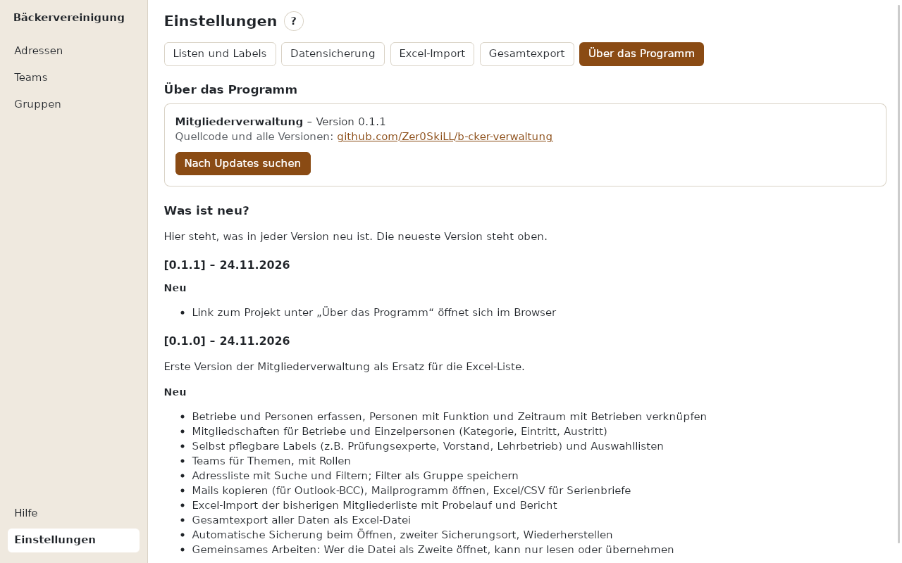

# Über das Programm

Hier sehen Sie die installierte Version, die Änderungen und suchen nach Updates.

Sie finden die Seite unter **Einstellungen** › **Über das Programm**.

- **Version:** die installierte Version. Geben Sie sie bei Fragen zum Programm an.
- **Nach Updates suchen:** prüft, ob es eine neue Version gibt. Wenn ja, erscheint oben die gelbe Leiste mit **Jetzt installieren** (siehe [Neue Version installieren](09-neue-version.md)).
- **Änderungen:** was in welcher Version neu ist.
- **Link zum Projekt:** öffnet die Projektseite im Browser, mit allen Versionen zum Herunterladen.

## Analysedaten senden

In der Einführungsphase hilft das Programm dem Entwickler, Probleme früh zu erkennen. Wenn etwas Auffälliges passiert (ein Absturz, eine Warnung, ein Befund beim Selbsttest), schickt es automatisch einen kurzen Bericht an den Entwickler, dazu etwa einmal pro Woche ein „alles in Ordnung“.

- **Was gesendet wird:** derselbe Bericht wie bei **Problem melden**: Programmversion, Betriebssystem, Name des PCs, Speicher- und Prozessorauslastung, Laufzeiten, Zustand der Datei und der Sicherung, die letzten Aktionen und das Programm-Protokoll. **Keine Mitgliederdaten**, kein Dateipfad und kein Windows-Benutzername.
- **Was wird gesendet?** zeigt den Bericht genau so, wie er jetzt gesendet würde.
- **Ausschalten:** Entfernen Sie das Häkchen bei **Analysedaten senden**. Die Einstellung gilt für diesen PC.
- **Befristet:** Das Senden endet automatisch am angegebenen Datum. Danach verschwindet der Schalter.
- Ohne Internet wartet der Bericht und wird später gesendet. Die Arbeit im Programm wird nie aufgehalten.
