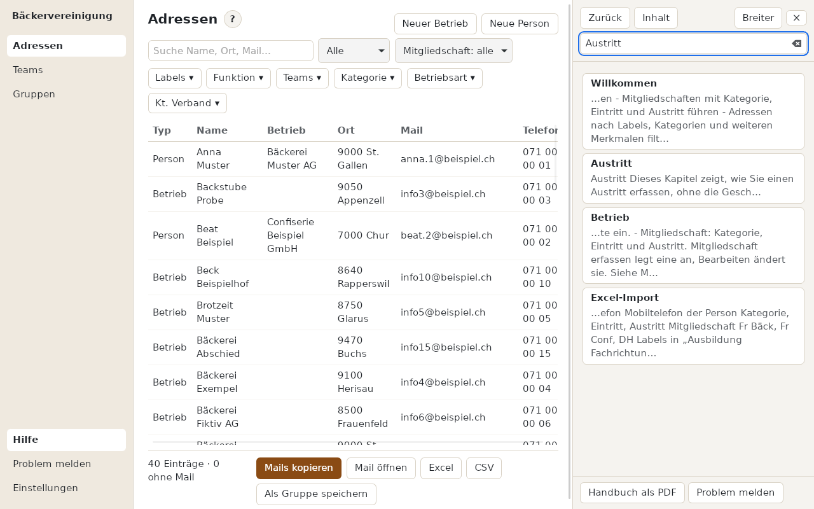

# Häufige Fragen und Probleme

Dieses Kapitel hilft, wenn etwas nicht wie erwartet funktioniert.

## Oben steht „Nur lesen“, ich kann nichts ändern

Jemand anderes hat die Datei geöffnet, oder das Programm wurde auf einem anderen PC nicht richtig beendet. Siehe [Programm starten und Datei öffnen](02-start-und-datei.md). Ist sicher niemand mehr daran, klicken Sie auf **Übernehmen**.

## „Datei nicht gefunden“ beim Öffnen

Die Datei wurde verschoben oder umbenannt, oder das Netzlaufwerk ist nicht verbunden.

1. Prüfen Sie, ob das Netzlaufwerk im Explorer erreichbar ist.
2. Klicken Sie auf **Datei öffnen…** und wählen Sie die Datei am neuen Ort.

Das Programm legt bewusst keine neue, leere Datei an, damit nicht aus Versehen zwei Dateien entstehen.

## Windows warnt bei der Installation: „Der Computer wurde durch Windows geschützt“

Das ist bei diesem Programm normal. Windows zeigt die Meldung bei Programmen ohne kostenpflichtige Herausgeber-Signatur. Klicken Sie auf **Weitere Informationen** und dann auf **Trotzdem ausführen**. Die Meldung erscheint nur bei der ersten Installation; Updates laufen danach ohne sie (siehe [Einrichten: allein oder zu mehreren](02b-einrichten.md)).

## Das Update schlägt fehl

Meist fehlt kurz die Internetverbindung. Klicken Sie auf **Erneut versuchen**, oder mit **Datei wieder öffnen** arbeiten Sie mit der bisherigen Version weiter. Siehe [Neue Version installieren](09-neue-version.md).

## Ich habe aus Versehen etwas gelöscht oder falsch geändert

Spielen Sie eine Sicherung von vor dem Fehler zurück: **Einstellungen** › **Datensicherung** › **Wiederherstellen**. Das Programm sichert vorher den aktuellen Stand. Siehe [Datensicherung und Wiederherstellen](08-sicherung-wiederherstellen.md).

## Gelbe Leiste „Kein zweiter Sicherungsort eingerichtet“

Richten Sie einen zweiten Ort ein, zum Beispiel einen USB-Stick: **Datensicherung einrichten** in der Leiste anklicken. Siehe [Datensicherung und Wiederherstellen](08-sicherung-wiederherstellen.md).

## Eine Kategorie, Funktion oder ein Label fehlt in der Auswahl

Legen Sie den Eintrag unter **Einstellungen** › **Listen und Labels** an. Siehe [Listen und Labels](15-listen-und-labels.md).

## „Mail öffnen“ ist ausgegraut

Entweder hat niemand in der Liste eine Mailadresse, oder es sind zu viele Adressen für das Mailprogramm. Nehmen Sie dann **Mails kopieren** und fügen Sie die Adressen in Outlook unter **Bcc** ein.

## Etwas funktioniert nicht, und hier steht nichts dazu

Erstellen Sie mit **Problem melden** einen Bericht und schicken Sie ihn dem Entwickler (siehe [Problem melden](21-problem-melden.md)).

## Die Hilfe finden

Klicken Sie auf das **?** neben dem Seitentitel oder drücken Sie **F1**. Oben in der Hilfe können Sie das ganze Handbuch durchsuchen. Ist ein Bild zu klein, klicken Sie darauf: Es erscheint dann gross. Mit **Breiter** wird die ganze Hilfe breiter.

