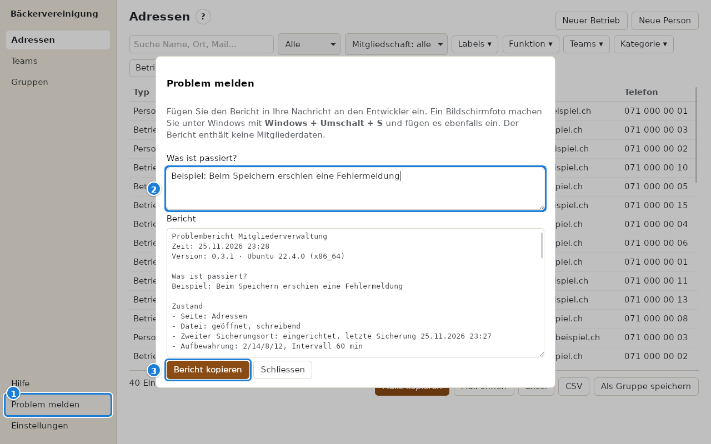

# Problem melden

Wenn etwas nicht wie erwartet funktioniert, erstellen Sie mit **Problem melden** einen Bericht für den Entwickler.

## So geht es

1. Klicken Sie in der linken Leiste auf **Problem melden** – oder unten in der Hilfe-Leiste (die Hilfe öffnen Sie mit **?** oder **F1**, auch auf der Startseite).
2. Beschreiben Sie unter **Was ist passiert?** in einem Satz, was Sie tun wollten und was geschah.
3. Klicken Sie auf **Bericht kopieren**.
4. Fügen Sie den Bericht in Ihre Nachricht an den Entwickler ein (Mail, Chat – wie gewohnt).
5. Ein **Bildschirmfoto** hilft oft sehr: Unter Windows drücken Sie **Windows + Umschalt + S**, wählen den Bereich aus und fügen das Bild ebenfalls in die Nachricht ein.

## Was im Bericht steht

- Programmversion, Betriebssystem, Datum und Uhrzeit
- die aktuelle Seite und ob die Datei nur zum Lesen offen ist
- der Stand der Datensicherung und die Einstellungen zur Aufbewahrung
- die letzten Aktionen, zum Beispiel „Seite: Adressen“ oder „Betrieb gespeichert – OK“, mit Uhrzeit
- die letzten Warnungen und Fehler des Programms

**Keine Mitgliederdaten:** Namen, Adressen, Mailadressen oder Ihre Eingaben in Formularen kommen im Bericht nicht vor – nur, *welche* Aktion stattfand. Sie sehen den ganzen Bericht, bevor Sie ihn kopieren.

Auch nach einem Absturz lohnt sich der Bericht: Die letzten Aktionen vor dem Absturz bleiben erhalten.
